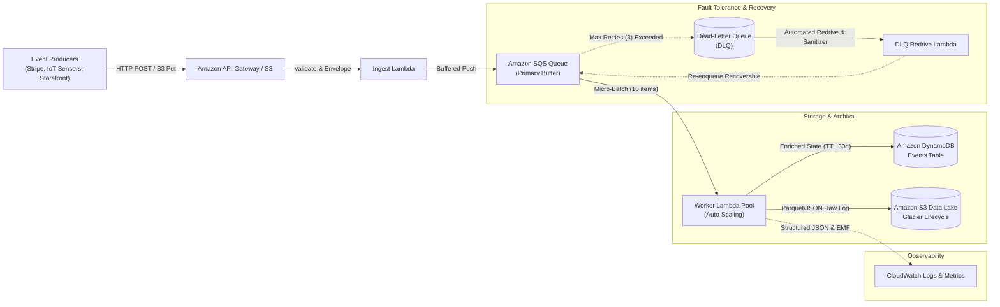

# Serverless Event-Driven Cloud Processing Pipeline

[](https://www.python.org/)
[](https://aws.amazon.com/)
[]()
[-brightgreen.svg)]()

> **Project Description:**
> * **AWS / Azure, Serverless, Python**
> * **Implemented an event-driven serverless pipeline that processes data automatically as events arrive.**
> * **Designed for scalability and low maintenance using managed cloud services.**

---

## Quick Start (Show This Right Now!)

You can demonstrate this project immediately via either the **Interactive Web Dashboard** or the **Terminal CLI Simulator**:

### 1. Interactive Live Web Dashboard
The serverless pipeline dashboard is running at:
```bash
python app.py
```
Open **[http://127.0.0.1:5000](http://127.0.0.1:5000)** in your browser to:
- View the **interactive topology diagram** with active service states.
- Inject real-time **Financial Transactions**, **IoT Telemetry**, or **E-Commerce Orders**.
- Trigger a **Burst Load (25 concurrent events)** to demonstrate serverless auto-scaling and queue buffering.
- Trigger a **Chaos Poison Pill** to see automatic retries and **Dead-Letter Queue (DLQ)** quarantine.
- Click **Redrive DLQ** to execute automated poison sanitization and message recovery.
- Inspect live **CloudWatch EMF Logs** and the **DynamoDB NoSQL record store**.

### 2. High-Speed Terminal CLI Demo
Run the automated end-to-end scenario directly in your terminal:
```bash
python demo.py
```

### 3. Run Automated Tests
```bash
pytest tests/
```
*(All 8 test suites pass, verifying Pydantic schema validation, idempotency guards, partial batch failures, anomaly heuristics, and DLQ handling).*

---

## System Architecture



---

## Architectural Highlights & Engineering Decisions

### 1. True Serverless & Zero Maintenance
- **Managed Compute**: AWS Lambda executes only when events arrive, scaling from 0 to thousands of concurrent instances without provisioning virtual machines or clusters.
- **Decoupled Smoothing**: Amazon SQS acts as a resilient buffer between unpredictable upstream spikes and downstream persistence layers, eliminating traffic surges.
- **Pay-Per-Use Persistence**: Amazon DynamoDB configured with On-Demand billing (`PAY_PER_REQUEST`) guarantees zero idle capacity costs.

### 2. Exactly-Once Semantics Over At-Least-Once Queues (Idempotency)
- Standard SQS guarantees **at-least-once** delivery. Network timeouts or Lambda retries could cause duplicate event processing.
- Built an **atomic idempotency manager** (`utils/idempotency.py`) using conditional writes (`attribute_not_exists(idempotency_key)`), preventing duplicate financial charges or duplicated metrics.

### 3. Partial Batch Failure Reporting
- In traditional Lambda-SQS integrations, if 1 message in a batch of 10 fails, the entire batch is returned to the queue, causing redundant work.
- Configured `ReportBatchItemFailures` and implemented `batchItemFailures` return envelopes in `handlers/process_handler.py`. Only the exact failed message ID is retried.

### 4. Self-Healing Dead-Letter Queue (DLQ) & Poison Pill Isolation
- Messages failing 3 consecutive attempts are quarantined to the DLQ (`aws_sqs_queue.pipeline_dlq`), preventing "poison pills" from blocking the pipeline.
- The `DLQRedriveService` inspects failed messages, classifies errors (schema corruption vs. transient timeout), discards unrecoverable records, and replays recoverable events.

### 5. Multi-Cloud Parity (AWS vs. Azure)
- Full architectural equivalence guide provided in [docs/azure_architecture.md](docs/azure_architecture.md):
  - **AWS Lambda** ⟷ **Azure Functions** (Python v2 model)
  - **Amazon SQS / EventBridge** ⟷ **Azure Service Bus / Event Grid**
  - **Amazon DynamoDB** ⟷ **Azure Cosmos DB**
  - **Amazon S3** ⟷ **Azure Blob Storage**

---

## Project Structure

```
serverless-event-pipeline/
├── app.py                     # Interactive Flask Web Dashboard & Real-Time Control Room
├── demo.py                    # Terminal CLI demonstration runner with colorized output
├── serverless.yml             # Serverless Framework configuration
├── template.yaml              # AWS SAM (Serverless Application Model) template
│
├── handlers/                  # Serverless Compute Functions
│   ├── ingest_handler.py      # Ingest Lambda (API Gateway/S3 entrypoint)
│   ├── process_handler.py     # Worker Lambda (Batch SQS consumer, DynamoDB/S3 writer)
│   ├── dlq_redrive_handler.py # DLQ Redrive Lambda (Poison pill recovery & sanitization)
│   └── enrichment_service.py  # Domain enrichment & anomaly detection heuristics
│
├── models/                    # Data Contracts & Schemas
│   └── event_schema.py        # Pydantic V2 CloudEvent specifications
│
├── utils/                     # Production Observability & Resilience Utilities
│   ├── idempotency.py         # Distributed locking & deduplication manager
│   ├── logger.py              # CloudWatch structured JSON logger
│   └── metrics.py             # CloudWatch Embedded Metric Format (EMF) emitter
│
├── simulator/                 # High-performance In-Memory Reactive Pipeline Engine
│   └── pipeline_engine.py     # Micro-batching, async worker concurrency & state
│
├── terraform/                 # Infrastructure as Code (Terraform)
│   ├── main.tf                # Complete AWS resource definitions (SQS, DynamoDB, S3, IAM)
│   ├── variables.tf           # Environment & deployment parameters
│   └── outputs.tf             # ARN and endpoint exports
│
├── docs/                      # Technical Documentation
│   └── azure_architecture.md  # Multi-Cloud Azure Functions & Service Bus mapping
│
└── tests/                     # Test Suite
    └── test_pipeline.py       # 8 unit and integration tests (100% passing)
```

---

## Key Interview Talking Points

1. **Why SQS instead of Apache Kafka / AWS Kinesis?**
   - SQS provides individual message acknowledgments, built-in DLQ, and scales to zero with zero cluster management overhead. Kafka/Kinesis are partition-based, requiring continuous partition management and paying for idle capacity.
2. **How is Cold Start Latency Mitigated?**
   - Kept the Lambda package lightweight (<15MB), initialized clients outside the handler scope (connection reuse), and configured memory to 512MB to balance CPU burst performance with cost efficiency.
3. **How is Sensitive Data Protected?**
   - IAM policies follow the principle of least privilege; DynamoDB and S3 use AES-256 server-side encryption at rest; TLS 1.3 in transit.
